# Burrow: a private notebook for your photos, talks and people

Burrow is an Android app that handles everyday jobs end to end, using small AI models that run **only on your phone**. These are jobs people usually hand to cloud apps. It's built on the [Desert Ant Labs](https://desertant.com) on-device models (`ai.desertant:*:4.2.1`), plus open speech models for Indian and other languages.

The current version is **3.5**. It uses the *hand-drawn minimal* design system in [`design/burrow-a/theme`](design/burrow-a/theme/THEME.md), and is built around the product rethink in [`design/burrow-a/PRODUCT.md`](design/burrow-a/PRODUCT.md).

**Contents:**
- [Showcase](#showcase)
- [The jobs](#the-jobs)
- [Ask Burrow](#ask-burrow-on-device-tool-calling)
- [Appearance](#appearance-light-or-dark-and-a-handwriting-level)
- [Design system](#design-system)
- [Research and decisions](#research-and-decisions)
- [What's next](#whats-next)
- [Version history](#version-history)
- [Repository layout](#repository-layout)
- [Build and test](#build-and-test)
- [Notes and limits](#notes-and-limits)

## Showcase

Every screenshot here is rendered from the real Compose code with sample data, by the screenshot tests (`./gradlew testDebugUnitTest`). There are more in [`design/burrow-a/theme/shots`](design/burrow-a/theme/shots).

<table>
<tr>
<td><br><sub>today: only what needs you</sub></td>
<td><br><sub>photos: tidy, sweep, vault</sub></td>
<td><br><sub>talks: record or import</sub></td>
<td><br><sub>a talk's notes</sub></td>
</tr>
<tr>
<td><br><sub>people and voices to name</sub></td>
<td><br><sub>a person's page</sub></td>
<td><br><sub>private sweep</sub></td>
<td><br><sub>the vault, locked</sub></td>
</tr>
<tr>
<td><br><sub>check a photo before sharing</sub></td>
<td><br><sub>mask text for an AI</sub></td>
<td><br><sub>privacy you can check</sub></td>
<td><br><sub>a talk in Hindi</sub></td>
</tr>
<tr>
<td>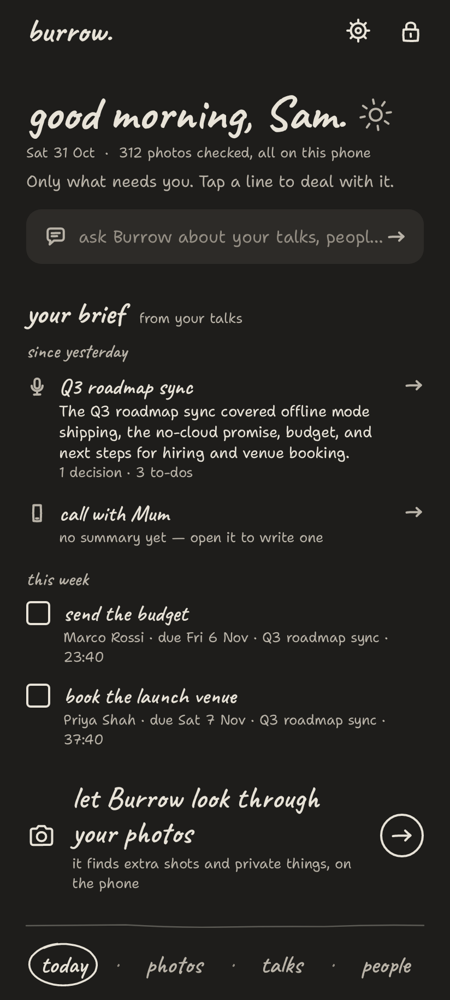<br><sub>dark: today</sub></td>
<td>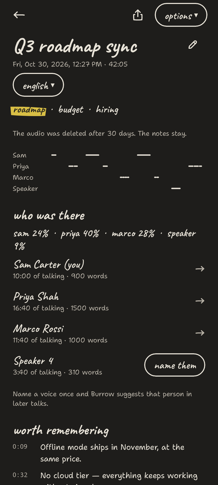<br><sub>dark: talk notes</sub></td>
<td>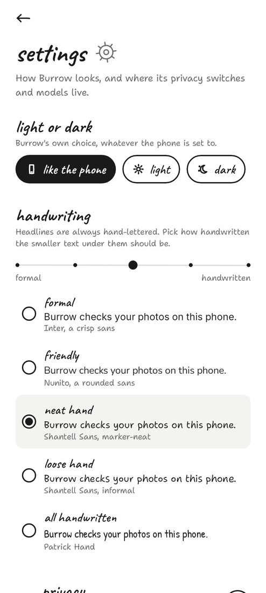<br><sub>settings: light/dark, handwriting</sub></td>
<td><br><sub>welcome</sub></td>
</tr>
<tr>
<td>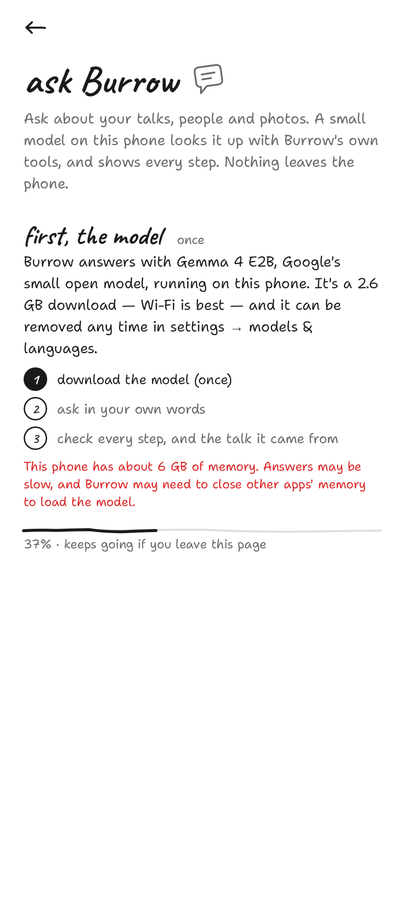<br><sub>ask: the one-time model download</sub></td>
<td>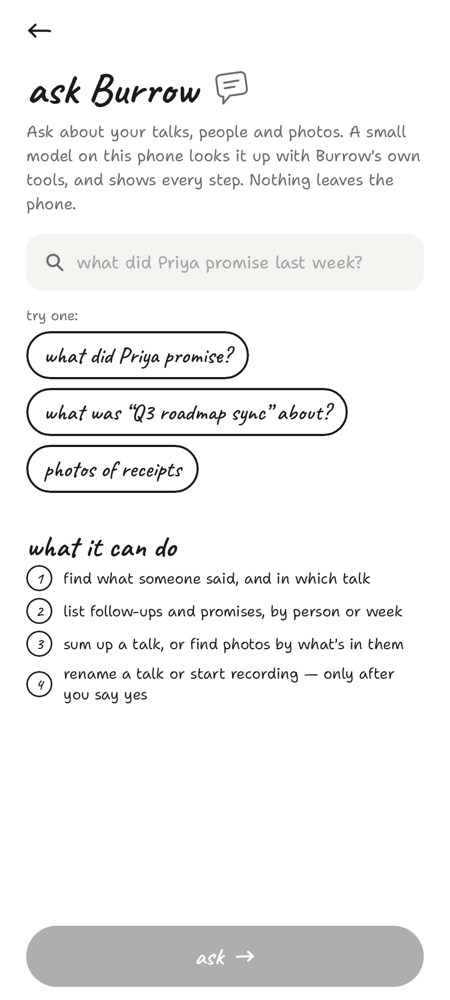<br><sub>ask: in your own words</sub></td>
<td>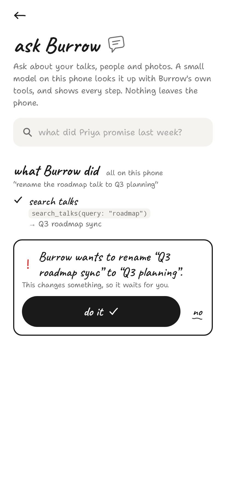<br><sub>ask: changes wait for you</sub></td>
<td>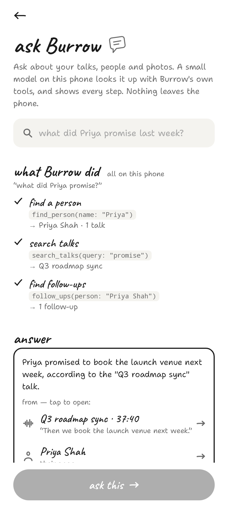<br><sub>ask: every step, every source</sub></td>
</tr>
<tr>
<td><br><sub>a person: contact, calls, chats</sub></td>
<td>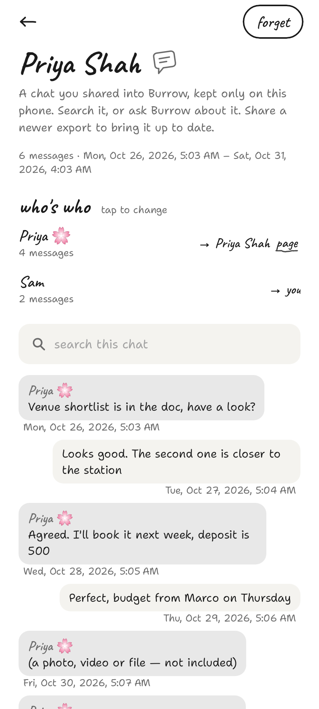<br><sub>a chat you shared</sub></td>
<td>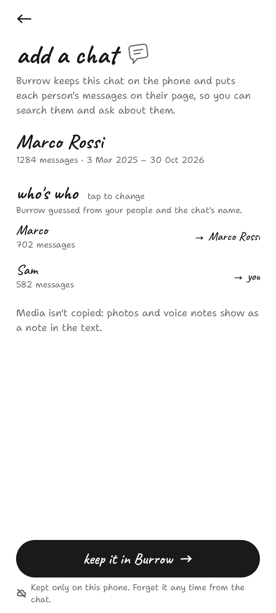<br><sub>add a chat: who's who</sub></td>
<td>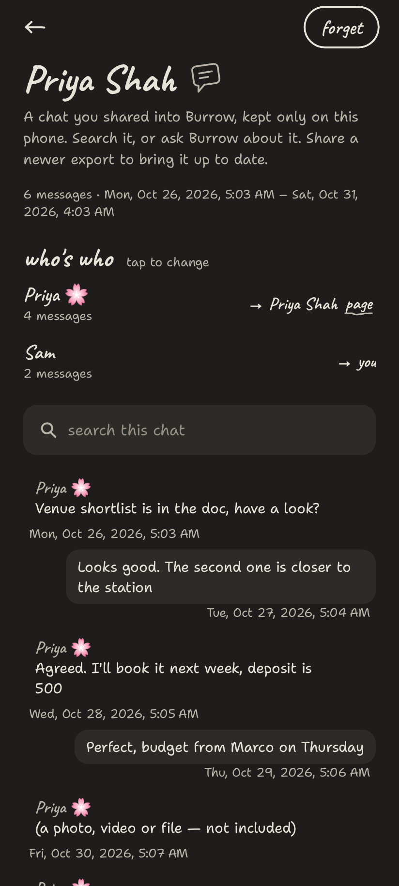<br><sub>dark: a chat</sub></td>
</tr>
</table>

A clickable HTML prototype of the design (17 screens, 8 journeys) is in [`design/burrow-a/prototype`](design/burrow-a/prototype). On a Fold's inner screen, tablets and in landscape, lists and details sit side by side ([`15-fold-inner-talks.png`](design/burrow-a/theme/shots/15-fold-inner-talks.png)).

## The jobs

| Job | Where | Models |
| --- | --- | --- |
| Tidy: keep the best shot of each moment, let the rest go | photos | Eye |
| Private sweep and vault: IDs, cards, medical and intimate photos taken out of the gallery and encrypted | photos → private things | Eye, then Moderator to confirm intimate photos |
| Share safely: check a photo before it leaves | Android share sheet → *Check with Burrow* | Eye, Moderator, plus the photo's EXIF data |
| Talks: record a conversation and get notes, who spoke when, and follow-ups | talks | Clear, Ear, Voz, Who, Gist, Redact; 22 Indian languages via AI4Bharat IndicConformer, others via Meta Omnilingual |
| People: name a voice once and Burrow suggests that person afterwards; their contact, call recordings and the chats you share are on their page | people | Who, plus Burrow's own voice signature |
| Mask: swap secrets for placeholders before text goes to an AI, then put them back in the reply | today → mask, any app's text-selection menu → *Mask with Burrow* | Redact, Tongue |
| **Ask**: questions about your talks, people and photos, answered on the phone by a small model calling Burrow's own tools | today → *ask Burrow…* | Gemma 4 E2B (LiteRT-LM) |

Navigation:
- **Bottom bar:** four hand-lettered words, **today · photos · talks · people**. *Today* shows only what needs you right now.
- **Top corners:** each home page has a gear (settings) and a padlock (privacy).
- **Every page:** opens with one sentence saying what it's for, and a doodle beside the title.

### Photos: clear the clutter

Your camera roll fills up with bursts, retakes, blurry shots and screenshots.

1. **Scan**: pick all photos or one album, and a period (30 days, 90 days, 1 year or all time). The scan runs in the background with a notification, and you can lock the phone. Photos already scanned are skipped, so rescans are quick.
2. **Similar shots**: near-duplicates taken moments apart are grouped into one *moment*. The best shot is starred and kept (eyes open, then the best faces, then the keeper score), and the others are preselected for deletion. Tap to change a choice, hold to look closer, or "Keep all".
3. **Throwaway shots and screenshots**: blurry, accidental, test or empty shots are listed separately, and so are screenshots.
4. **Move to trash**: one system-confirmed step moves the selection to Android's trash, where it stays recoverable for 30 days. A header shows how much space you can free.
5. **Find photos** by what's in them: "dog", "beach", "receipt", "smiling".

Uses **Eye**: scene and quality tags, faces, embeddings, `Eye.duplicates` and `Eye.best`.

### Talks: record, understand, remember

1. **Record** a meeting. It keeps going with the screen off, from a foreground service with pause/stop in the notification. You can also **import** any audio or video file, or bring in **call recordings**: Android doesn't let apps record calls, but Samsung's Phone app can (Phone → Settings → Record calls), and Burrow lists those recordings for one-tap import.
2. **Processing** happens in the background, on the phone, in this order:
   1. Ear identifies the language.
   2. The right speech model writes the transcript with word timings. That's Voz, IndicConformer or Omnilingual; see the languages section below. Audio goes in about 10-minute chunks, cut at pauses.
   3. Who works out who spoke when.
   4. Gist finds topics and highlights.
   5. Burrow pulls out follow-ups.
   6. Voices are matched to people.
3. **The meeting page** shows:
   - the title (auto-named from the topics), date, length, language and topics;
   - a player with a speaker timeline: tap anywhere to jump there;
   - **Who was there**: each speaker's talk time and share, with "Sounds like Alice · 84% voice match ✓ ✗";
   - **Highlights**: key sentences spread across the meeting;
   - **Possible follow-ups**: commitments such as "I'll send…" or "we need to…" (English phrasing);
   - **Transcript** as chat bubbles coloured per speaker; tap a line to play it, the current line lights up, and you can search inside it.
4. **Search across every transcript**, and **share notes**, optionally with names, numbers, emails and addresses **redacted on the phone first** (Redact).

### Talks in Indian and other languages

Ear identifies the spoken language of each talk, and you can also set it by hand with the "language ▾" button on a talk. Burrow then picks the model that writes it:

| Language | Model (on the phone) | Download |
| --- | --- | --- |
| Voz's 25 European languages | Voz | built in |
| **All 22 scheduled Indian languages**: Hindi, Bengali, Marathi, Telugu, Tamil, Gujarati, Urdu, Kannada, Odia, Malayalam, Punjabi, Assamese, Maithili, Santali, Kashmiri, Nepali, Sindhi, Konkani, Dogri, Manipuri, Bodo, Sanskrit | AI4Bharat **IndicConformer** (MIT), int8, run with ONNX Runtime | about 190 MB per language |
| Every other language (1,600+) | Meta **Omnilingual ASR** 300M CTC (Apache-2.0), int8 | about 350 MB, once |

When packs download:
- Only when you ask: from onboarding, *settings → models & languages*, or a talk that needs one.
- Never while "never go online" is on.
- A talk in a language whose pack isn't on the phone stops with a one-tap download, instead of producing a garbled transcript.

Topics and follow-ups are skipped for these languages for now, because Gist and the follow-up phrases are tuned for European languages. The transcript, speakers and people all work as normal. Why these models were picked is under [Research and decisions](#speech-models-for-indian-languages).

### People: speaker profiles

Who tells speakers apart within one recording. Burrow links them across recordings:

- **Name a speaker once** ("Who is this?" → pick a person, "This is me", or a new name). Burrow learns that voice from the recording.
- **Next time** that voice is heard, the meeting suggests the person with a match score, and you confirm or dismiss it. Every confirmation improves their voice profile. You can also record a 15-second voice sample on a person's page.
- **A person's page** shows:
  - their conversations, total talk time and share per meeting;
  - the languages they speak;
  - **what they talk about**: Gist topics rolled up across meetings, weighted to recent ones;
  - quotes in their own words, and links to every meeting.
- The **voices to name** inbox collects unnamed speakers from recent meetings.

**Contacts, calls and chats.** A person's page brings together everything about them, without Burrow reading your phone behind your back.

- **Their contact.** *link their contact* opens Android's own contact picker.
  - You pick them, and Android hands Burrow just that one entry: name, number, and which contact it is.
  - Burrow has **no contacts permission** and never reads the address book.
  - Once linked, the page has **call**, **message** and **contact** buttons. These open your phone and texting apps.
- **Call recordings.** Samsung's recorder names each file after the contact or number, e.g. `Call recording Priya Shah_241030_181205.m4a`.
  - Burrow reads that name and puts the recording under **calls** on that person's page. It matches the number on their linked contact, their name, or a name they go by. Other phones' patterns, like `Name(+number)_20241030181205`, work too.
  - The call is titled "call with Priya".
  - When processed, the voice that isn't yours is suggested as them. One tap confirms it, and that's when the voice is learned.
- **Chats, only the ones you share.** In WhatsApp: open the chat → ⋮ → More → *Export chat* → *Without media* → **Add chat to Burrow**. Burrow then:
  - shows what it found and guesses **who's who** (you can change it);
  - keeps the messages on the phone, linked to each person. The name they use in the chat ("Priya 🌸", "Mum") is remembered, so their calls and later chats link too;
  - replaces the older copy when you export the same chat again;
  - doesn't copy media.

  You can search a chat, ask Burrow about it, or forget it.
- **What Burrow doesn't do.** It has no SMS, call-log or contacts permission. Those are restricted on the Play Store, and nothing here needs them. Burrow never reads messages from other apps on its own.

*How voice matching works:*
- **The signature:** the Who SDK doesn't expose its internal voice embeddings, so Burrow computes its own compact voice signature: MFCC statistics plus median pitch over each speaker's own turns.
- **You confirm:** each match is a suggestion you confirm; nothing is linked without you.
- **Best fit:** a handful of regular contacts recorded on the same phone.

### Private sweep and vault

During the photo scan, Eye flags IDs and bank cards, receipts, medical photos and documents. Any photo Eye thinks might be intimate gets a second check from **Moderator**. *photos → private things* lists what it found, blurred. One move puts the photos in the **vault**:

- Each photo, its thumbnail and the vault's index are encrypted with **AES-256-GCM** under a random data key.
- That data key is stored only wrapped by an **Android Keystore** key. That key can't be exported and needs your **fingerprint or screen lock for every use**.
  - Opening the vault is one prompt bound to that unwrap (a `BiometricPrompt.CryptoObject`).
  - So it behaves the same on every phone and never "times out" in the middle of adding photos.
- If the screen lock is removed, Android destroys the key. Burrow says so plainly and offers to start a new, empty vault.
- The vault lives in `noBackupFilesDir`, and the app opts out of backup, so the vault never reaches a cloud backup. The gallery and other apps can't see it.
- Once the photos are copied in, Android asks you to delete the originals. If you say no, the vault copies are removed again.
- The vault locks as soon as you leave Burrow, and it forgets its decrypted thumbnails when it does.
- You can put any photo back in the gallery (*Pictures/Burrow*), or delete it for good.

### Share safely

Burrow appears in Android's share sheet for photos as **Check with Burrow**. It looks for faces, ID and bank cards, documents, intimate content (confirmed by Moderator), and location or camera data in the file. Each finding comes with a fix:

- crop to the main subject, using Eye's smart crop;
- blur (pixelate) faces;
- remove location and camera data: the clean copy is re-encoded, so it carries no metadata at all.

Burrow then passes the clean copy on to the app you were sharing to. You can also send the original.

### Mask

Paste text, share text to Burrow, or select text in **any app** and choose **Mask with Burrow**. Redact swaps names, emails, phone numbers, addresses, cards and IDs for placeholders like `[NAME_1]`. You then:

1. copy the masked text, or, in an editable field, put it straight back in place of your selection;
2. paste it into ChatGPT or a form;
3. paste the reply back into Burrow, which restores the real details on the phone.

The masked text is held in memory only, and Burrow forgets it after 30 minutes. A restored reply is copied with Android's "sensitive" clipboard flag.

### Privacy you can check

The **privacy page** (the padlock icon) shows:

- **A ledger**: everything Burrow did today and since setup ("checked 312 photos", "transcribed 1 talk", "learned 1 voice, with your OK"). It's counted on the phone.
- **The real number of bytes Burrow has sent**, read from Android's `TrafficStats` for the app.
  - The only network traffic is requests for model files.
  - There's no upload code, no account and no analytics.

It also has switches, and each one is enforced in code:

- **never go online**: the model hub refuses to download anything. Onboarding offers to turn this on once the models are in place.
- **lock with fingerprint**: Burrow asks again when you come back after 30 seconds away.
- **delete talk audio after 30 days**: the notes and transcript stay.
- **learn voices when I name someone**: when this is off, naming a speaker teaches Burrow nothing.
- **hide every screen from screenshots**: off by default, so you can share screenshots of Burrow. The vault, the private sweep and the mask screen are always blocked from screenshots and the recent-apps preview.

Deleting things:
- **Wipe everything** forgets every analysis, talk and its audio, person and voice, the vault, the ledger and the settings. Deleting the downloaded models is an option. Your gallery isn't touched.
- **Forget this person** deletes one person's voice and unlinks them from every talk.

Permissions are requested on the *ask first* onboarding page, with one line saying why each is needed.

### Also inside

*settings → models & languages → Model lab* has a playground for each of the 11 Android models, for trying them on their own: Voz, Ear, Who, Clear, Eye, Moderator, Redact, Gist, Emo, Tongue and Shapes.

## Appearance: light or dark, and a handwriting level

*Settings* (the gear) has two choices, both stored on the phone:

- **light or dark:** *like the phone*, *light* or *dark*, independent of the system setting. The status-bar icons follow Burrow's choice.
- **handwriting:** the body text under the hand-lettered headlines comes in five voices, from formal to fully handwritten. Each row previews itself.

| Voice | Font | Feel |
| --- | --- | --- |
| formal | Inter | crisp UI sans (Burrow 3.0–3.2) |
| friendly | Nunito | rounded sans |
| **neat hand** (default) | Shantell Sans, informality 0 | marker-neat; bridges Caveat and a sans |
| loose hand | Shantell Sans, informality 100 | bouncier, more personal |
| all handwritten | Patrick Hand | a notebook throughout |

**Why there are voices.** Caveat headlines over Inter body text jumped from 100% casual to 100% formal. The middle voices close that gap. Here are the same screens in all five voices, left to right:


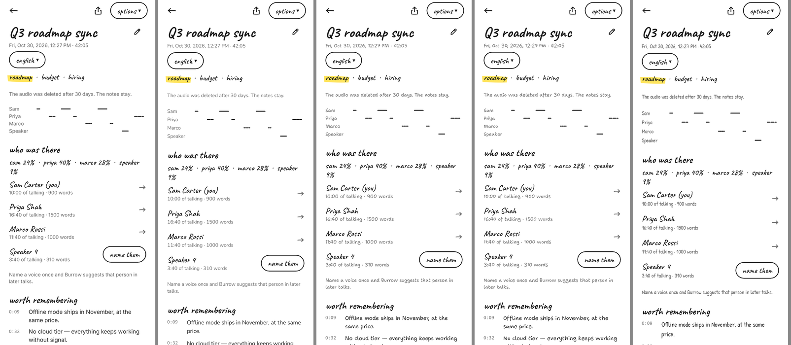

**Why dark mode changed.** In 3.2, dark mode was near-white on near-black.
- Thin hand-drawn strokes bloomed and blurred.
- The yellow highlight and the white primary button glared.
- Input wells and dividers disappeared.

In 3.3, dark mode is a warm charcoal "night notebook":
- paper `#1E1D1B` and ink `#E8E3D8`, about 12:1 contrast;
- a toned-down marker `#D9BF45`;
- visible wells (`#2D2B28`) and rules (ink at 30%);
- every text colour passes WCAG AA.

| before (3.2) | after (3.3) |
| --- | --- |
| 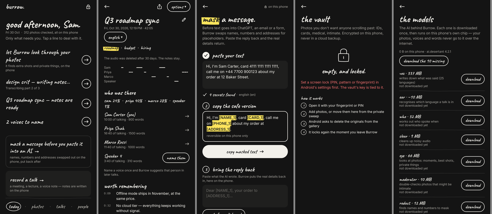 | 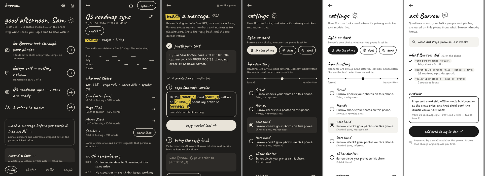 |

## Design system

The *hand-drawn minimal* design system is documented in [`design/burrow-a/theme/THEME.md`](design/burrow-a/theme/THEME.md), with values in [`tokens.json`](design/burrow-a/theme/tokens.json).

**The rules:**
- paper, ink and one yellow marker swipe per screen;
- one black ink pill as the primary action;
- no cards and no shadows;
- words for navigation;
- photos shown as small tilted snapshots;
- red pen only for private or destructive states.

**Type:**
- **Caveat** for headlines, numbers, buttons and navigation;
- the chosen **body voice** (above) for explanations and meta lines;
- monospace for placeholders like `[NAME_1]` and for timestamps.

All fonts are bundled under the SIL Open Font License; the licences are in `design/burrow-a/theme/fonts/`.

**Doodles:** 36 hand-drawn icons drawn as Compose paths with a pencil wobble (`ui/hand/Doodles.kt`).
- Every page title has its own doodle.
- Today's rows have small leading doodles.
- The greeting gets a sun or a moon.

**Components** (`ui/hand`):
- `HandPage`, `PageIntro`, `InkButton`, `PillButton`, `ChoicePill`, `HandLink`, `Door`;
- `HandSwitch`, `HandField`, `HandTag`, `Steps`, `Snapshot`, `HandNav`, `HandSheet` and more.

The theme lives in `ui/theme`: `Theme.kt` for colours, type and voices, and `Appearance.kt` for the stored setting and system bars.


**How the design was chosen:**
1. Three directions were explored in Google Stitch (see [`design/README.md`](design/README.md) and [`design/briefs`](design/briefs)):
   - A, hand-drawn minimal;
   - C, monochrome pop;
   - D, almost nothing.
2. Version A was picked and turned into the clickable prototype.
3. It then became this app.

## Research and decisions

### One app, not three

Burrow stays one app:
- **Shared models.** The models are the heavy part: about 490 MB to download, plus a ~240 MB APK. Three apps would download them up to three times.
- **Connected jobs.** A named voice links to its talks, and a photo found by the sweep goes into the vault. Separate apps would break those links.
- **One privacy story.** One lock, one vault, one ledger and one "wipe everything" is easier to trust.
- **Small-tool feel stays.** Mask and share check still feel like small tools, because they live in other apps' share sheet and text-selection menu.

If one ever splits out, Mask is the candidate: it's small and only needs Redact.

### Desert Ant models used, and not used

| Model | Android SDK | In Burrow |
| --- | --- | --- |
| Voz, Ear, Who, Clear | yes | the talks pipeline |
| Eye, Moderator | yes | photos, sweep, share check |
| Redact, Tongue | yes | mask, redacted sharing |
| Gist | yes | topics, highlights, people's topics |
| Emo, Shapes | yes | Model lab only |
| **Align** (refines transcript word timings) | **no**: Apple, Linux, Windows and Node only; `ai.desertant:align` isn't on Maven, and the JS build is Node-only | not used |
| Title, Uhm, Clips, Face (beta), Toxic | newer; check before adopting | candidates (see below) |
| **Schemer** (structured JSON from text; 211M params, ~230 MB int8, 13 languages) | closed beta, not on Android Maven yet | candidate |

What Align would add:
- Voz already gives word times at about 80 ms resolution, so Align is polish.
- It would give exact tap-to-play starts and better speaker attribution in crosstalk.
- It would allow word-by-word highlighting during playback.
- It's a small change once an Android SDK ships: run it after Voz.

### Speech models for Indian languages

Each candidate model was measured on 60 Google FLEURS test clips per language. Lower is better. The full table, with CER, speed and the Burrow-pipeline check, is in [`tools/asr-eval`](tools/asr-eval/README.md).

| Model | Hindi WER | Tamil WER | Bengali WER | Download |
| --- | --- | --- | --- | --- |
| **AI4Bharat IndicConformer, int8** (used) | **11.5%** | **31.7%** | **16.3%** | ~190 MB / language |
| Meta Omnilingual ASR 300M CTC, int8 (fallback) | 33.4% | 56.5% | 34.9% | 349 MB, once |

- **Pipeline check:** Burrow's own Kotlin pipeline (`speech/MelFeatures.kt` + `speech/CtcDecoder.kt`) scores within half a point of the reference sherpa-onnx run. Its features match the Python reference to within float rounding.
- **Tamil:** WER looks high for every model because Tamil joins words; its CER, about 15%, is the fairer measure.
- **Not tested yet:**
  - **SraVaani‑1.0** (IISc/ARTPARK, 65 Indian languages and dialects) and the official **IndicConformer 600M multilingual** are gated on Hugging Face. They need a token from an account that has accepted their terms. SraVaani would also need converting from TorchScript to ONNX.
  - **Whisper**, including Hinglish fine-tunes, needs an encoder-decoder runtime that Burrow doesn't have yet.

## Ask Burrow: on-device tool calling

Ask in your own words, for example "what did Priya promise?", "when is Marco sending the budget?" or "photos of receipts". A small language model on the phone reads the question and calls Burrow's own functions as **tools**. Burrow runs them against its local database and hands the results back. The model then answers from those results only.

**Setup:**
- **The model:** Google's **Gemma 4 E2B** (Apache-2.0, the `litert-community` LiteRT-LM build), run by **LiteRT-LM** 0.16.1. It uses the GPU where the phone allows and the CPU otherwise.
- **Download:** about 2.6 GB, once, only when you ask. It resumes if cut off, and never downloads while "never go online" is on. It's listed under *settings → models & languages*, where it can be removed. *Wipe everything* with models also removes it.
- **Memory:** it's loaded only while the ask page is open, and freed a minute after you leave. Phones with less than 8 GB of memory get a warning.

| Tool | What it does | Changes anything? |
| --- | --- | --- |
| `find_person` | people you've named: their talks, calls, chat messages and topics | no |
| `search_talks` | talks by words said, title, topic, person or date, with the matching lines | no |
| `follow_ups` | promises and to-dos, by person, talk or date | no |
| `talk_details` | one talk: who talked how much, topics, highlights, follow-ups | no |
| `search_messages` | messages in chats you shared, by words, person or date | no |
| `find_photos` | photos by what's in them (never intimate ones) | no |
| `rename_talk` | gives a talk a new title | **yes: asks you first** |
| `start_recording` | opens the recorder | **yes: asks you first** |

**How it's built** (`app/src/main/kotlin/…/ask/`):
- **Manual tool loop (`AskAgent`).** Tool calling is handled by Burrow, not left to LiteRT-LM, for four reasons:
  - each step shows on screen as it happens;
  - tools that change things wait for "do it";
  - unknown tools and bad arguments go back to the model as errors;
  - the loop stops after 5 rounds.
- **Honest answers.** If you say "no" to a change, Burrow writes the answer itself. In testing, the model claimed to have done the change anyway.
- **Citations.** Sources are picked by Burrow, not the model: only the talk lines whose words the answer actually uses, plus people it names. Each one opens that talk at that moment, or that person's page.
- **Tools (`BurrowTools`).** Results are compact JSON in plain words ("today (Fri 31 Oct)", "28:20", names rather than ids), to save the small model's context.
- **Privacy.** Questions and answers live in memory only, and the ledger counts "answered N questions". Nothing is sent anywhere.

**Tested with the real model.** `AskLiveTest` runs Gemma 4 E2B with LiteRT-LM on the build machine's CPU, against the sample data, through the same code the app uses.
- It chose the right tools for 8 of 8 questions.
- It invented nothing.
- It took 4.5–10 s per question.

The full transcript is in [`tools/ask-eval`](tools/ask-eval/README.md). It hasn't been run on a phone yet.

## What's next

1. **Let Gemini and other assistants use Burrow.**
   - **How:** Android AppFunctions (`androidx.appfunctions`, Android 16+). The same tools could be exposed to the system assistant.
   - **Safeguards:** consent per call, and Redact masks names before anything leaves.
   - **Status:** alpha API, with Gemini integration in private preview.
2. **Newer Desert Ant models.**
   - **Schemer:** typed follow-ups and events, once it reaches Android.
   - **Title:** names talks.
   - **Uhm:** strips filler words.
   - **Face (beta):** groups people in photos.
3. **Ask, further:**
   - stream the answer word by word;
   - follow-up questions in the same conversation;
   - tools for the vault (behind its fingerprint) and for masking text.
4. **Redact as a guard for cloud tools.** If a cloud model is ever used, the mask flow swaps names and numbers for placeholders first.

The original concept screens are in `design/burrow-a/explorations/ask-concept-*.png`.

## Version history

| Version | What changed |
| --- | --- |
| 1.0 | A showcase with a playground for each of Desert Ant's 11 Android models |
| 2.0 | Rebuilt as Burrow around three jobs: photo cleanup, meeting notes, speaker profiles. Background processing in windows; foldable layouts |
| 3.0 | Hand-drawn minimal redesign. Onboarding; Today; private sweep and vault; share check; mask; privacy page with ledger and byte counter |
| 3.1 | UX pass: every page says what it does, what's tappable and what's next. The vault rebuilt on a biometric-bound wrapped key. Hindi talks via IndicConformer. New adaptive icon |
| 3.2 | Talks in all 22 scheduled Indian languages, with Omnilingual for 1,600+ others. Choose a talk's language by hand. ASR evaluation in `tools/asr-eval` |
| 3.3 | In-app light/dark setting; readable warm dark mode; five handwriting levels; more doodles; a gear on every home page; tool-calling concept |
| 3.5 | **People, connected**: link a person to their phone contact (picker, no contacts permission); call recordings linked by the name or number in the file; WhatsApp chats added through the share sheet, with who's who; call/message buttons; ask Burrow searches chats. Database v4 |
| 3.4 | **Ask Burrow**: Gemma 4 E2B on the phone with LiteRT-LM, calling eight Burrow tools; changes need your OK; cited answers. Resumable model downloads. Kotlin 2.2. Wipe also removes downloaded language packs |

Release APKs are built into `dist/`, which is git-ignored.

## Repository layout

```
app/src/main/kotlin/com/showcase/desertant/
  ui/theme/        colours, type, voices, Appearance (light/dark + voice setting)
  ui/hand/         the hand-drawn components and doodles
  ui/shell/        navigation (BurrowApp), lock screen
  ui/today, photos, meetings, people, mask, privacy, settings, onboarding, share, ask
  chats/           shared chat exports: ChatParser (WhatsApp formats), ChatImporter
  people/          voices, People, Contacts (picker + matching), CallLinks
  ask/             ask Burrow: AskAgent (tool loop), BurrowTools, AskModel (Gemma + LiteRT-LM), AskSession
  ui/models/       the Model lab playgrounds
  photos/ meetings/ people/ privacy/ audio/ image/   the engines behind each job
  speech/          IndicConformer + Omnilingual: SpeechPacks, MelFeatures, CtcDecoder
  core/            ModelHub: Desert Ant model loading and downloads
  data/            Room database (version 4) and DAOs
app/src/test/      screenshot tests (ScreenshotsTest, DarkScreenshotsTest, DesignSystemTest,
                   ExplorationTest) and unit tests (SpeechTest, VaultCryptoTest,
                   VoiceSignaturesTest, MeetingTextTest, AskAgentTest, AskLiveTest,
                   ChatParserTest)
design/            design directions, briefs, the Burrow A theme, prototype and explorations
tools/asr-eval/    the speech-model evaluation script and results
tools/ask-eval/    the live ask Burrow run with the real model, and how to repeat it
```

## Build and test

Requirements: JDK 17 and Android SDK 35 (or Android Studio). The build targets **arm64-v8a**, Android 11+.

```bash
./gradlew assembleRelease    # app/build/outputs/apk/release/app-release.apk (R8-optimized)
./gradlew testDebugUnitTest  # unit tests, plus screenshots:
                             #   app/build/shots/    every screen, light and dark
                             #   app/build/explore/  handwriting voices, settings, tool-calling concept
```

- **Signing:** the release APK is signed with the debug key so it installs directly. Use your own signing config before publishing.
- **Emulator:** to run on an x86_64 emulator, add `"x86_64"` to `abiFilters` in `app/build.gradle.kts`.
- **License key (optional):** Desert Ant models are free for most apps. If you have a publishable key, enter it in settings or put `desertant.apiKey=pk_live_...` in `local.properties`.

Screenshots are rendered with Robolectric and Roborazzi in native graphics mode, so they come from the real Compose code without an emulator.

## Notes and limits

- **Size:** the APK is about 250 MB, because each native model carries its own runtime, plus ONNX Runtime and LiteRT-LM. First use downloads the weights:
  - Voz about 337 MB, Eye 66 MB, the other Desert Ant models 1–32 MB;
  - an Indian-language pack about 190 MB each, Omnilingual about 350 MB;
  - the ask model 2.6 GB, only if you use ask.
- **Speed:** a few hundred photos take a few minutes. A meeting takes a fraction of its length to process once the models are on the phone.
- **Long recordings:** up to 2 hours. Very long recordings may hit the phone's memory limit, and the app says so if that happens.
- **Languages:** topics, highlights and follow-ups are tuned for European languages. Talks in other languages get a transcript, speakers and people, but no topics yet.
- **Testing:** everything is verified by unit and screenshot tests, and ask Burrow with the real model on a desktop CPU. Hardware flows (fingerprint, vault, share sheet, recording, ask on a phone's GPU) need checking on a real phone.

## License

- **Desert Ant models and SDK:** the [Desert Ant Labs Source-Available License](https://license.desertant.com/), free for most apps, with a commercial license required at scale.
- **IndicConformer:** MIT.
- **Omnilingual ASR:** Apache-2.0.
- **Gemma 4 and LiteRT-LM:** Apache-2.0.
- **Fonts:** SIL Open Font License.
