# Burrow theme: Hand-drawn Minimal

The look of the app reads like a neat notebook page. The paper is white, everything is drawn in ink, and one yellow marker swipe per screen shows what matters. The headings, buttons and navigation words are hand-lettered in Caveat; everything you actually read is a plain, clearly legible sans (Nunito by default) in ink.

**4.0, the readable edition** (tokens 2.0.0, from the platform's readability review in `baseApp/design/REVIEW.md`): hand-lettering went back to being a heading and a button. Caveat is never under 24 sp and never carries data or user content; sentences are ink at 16 sp, long-form text 17 sp; grey is darker; nothing readable is under 13 sp; every tap target is at least 48 dp. Pages are about 15–20% taller. That's the price, and it's worth paying.

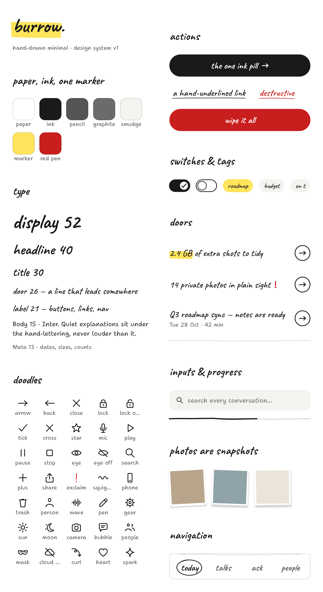

The theme exists in three places, and all three hold the same values:

| Where | What |
| --- | --- |
| [`tokens.json`](tokens.json) | The source of truth: colors (light and dark), type, spacing, stroke and motion |
| `app/src/main/kotlin/…/ui/theme/Theme.kt` | `BurrowTheme`. It maps the tokens onto Material 3 roles, so that any Material widget still in use (menus, dialogs) also comes out in paper and ink |
| `app/src/main/kotlin/…/ui/hand/` | The hand-drawn components and the doodle icon set |
| [`fonts/`](fonts) | Caveat, Nunito, Inter and Shantell Sans, all under the SIL Open Font License, bundled in the app with no runtime download |

## Principles

1. **Each screen has one idea and one ink pill.** Every screen gets a single black primary button. Anything secondary is a hand-underlined link.
2. **Only one thing gets the marker, and it's a fact.** The yellow swipe goes behind a single number or a word or two per screen (16 characters at most), such as "2.6 GB", "3 things" or "nothing". Never a page title, a tag row or a sentence.
3. **Content sits on the paper, not on cards.** There are no cards or boxes around text, gradients or shadows. Summaries and answers sit on the paper; sections are separated by white space and sketchy hairlines. The only filled shape is the pale "smudge" well behind inputs and quoted text.
4. **Words do the navigation.** The bottom bar is four hand-lettered words (*today · talks · ask · people*), and the current one gets a loose hand-drawn circle around it. There's no icon tab bar. Photos and mask open from today's *tools*.
5. **You read in the body face; you tap, and find your place, in hand-lettering.** Caveat is for the app's own short words: the wordmark, page titles, section heads, places ("mask a message", "privacy"), buttons, links and nav words, four words or fewer. Names of talks, people, models and files, numbers, dates and anything the user wrote are set in the body face, with their real capitals.
6. **Photos are snapshots.** They appear small, with a white border, slightly tilted, and with a 2 dp lift. Private photos are always blurred in two ways: the image is decoded at about 24 px and the blur is applied on top, so it stays unreadable even on Android versions that don't support blur.
7. **The red pen is a mark, not a paragraph.** It's used for the "!" doodle, destructive buttons and links (*delete*, *wipe everything*). A warning is an ink sentence with a red "!" in front (`Warning`).
8. **The text tells the truth.** For example, "recoverable for 30 days", "nothing of yours left this phone" (shown with the real byte count) and "learned 1 voice, with your OK".

## UX rules

These came out of the first round of use, when people said they were lost on some pages.

1. **Every page says what it's for.** A `PageIntro` opens each page: the page's name and one plain sentence about what you can do there.
2. **Anything tappable looks tappable.** Live rows (`Door`) end in a circled arrow. Rows that lead nowhere are drawn in pencil, with no arrow. Actions are buttons (the ink pill, or the outlined `PillButton`); underlined text is only for minor, tertiary actions.
3. **No hidden gestures.** There's no long-press and no tap-on-a-title to rename. Choices are drawn on the photo itself (`PickMark` plus a "keep" or "let go" label), and "look closer" is a visible eye button.
4. **Flows say their steps up front.** `Steps` lists what will happen, such as fingerprint, then copy, then Android's delete prompt. `StepHead` numbers the stages of a page like Mask.
5. **After something happens, say so and offer the next step.** `DoneNote` reports the result inline ("Let go of 12 photos… back to photos"). Failures explain what to do, such as "download Hindi" or "set a screen lock".
6. **Permissions show their state.** Each one shows either "allowed ✓" or an "allow" button, and a "settings" button once Android won't ask again. A switch is never used for something that can't be switched back off.

## Reading voice and light/dark

Headings are always Caveat. The face you read in is a **voice** the user picks in *Settings → handwriting*; each row shows a live sample:

| Voice | Font | Feel |
| --- | --- | --- |
| **friendly** (default) | Nunito 400/600 | rounded, warm next to Caveat, reads cleanly at 13–17 sp |
| formal | Inter 400/600 | the crispest option |
| neat hand | Shantell Sans, informality 0 | for people who want handwriting throughout |

"loose hand" and "all handwritten" (Patrick Hand) were removed in 4.0: one moved letters off the baseline, the other needed enlarging to be legible. All three voices use the same sizes. The first start of 4.0 moves every install to *friendly* once (every earlier install had the old default, *neat hand*, stored) and says so once on the settings page; a stored "loose" or "all handwritten" becomes *neat hand*.

*Settings → light or dark* chooses like the phone, light, or dark, independent of the phone. The status-bar icons follow Burrow's choice. Dark is a warm charcoal "night notebook" (see the tokens below), not white on black: that combination made the thin hand strokes bloom and the yellow highlight glare.

## Tokens (2.0.0)

| Token | Light | Dark | Use |
| --- | --- | --- | --- |
| paper | `#FFFFFF` | `#1E1D1B` | Background |
| ink | `#1A1A1A` (17.4:1) | `#E8E3D8` (13.2:1) | Text, doodles, the ink pill. Sentences are ink |
| pencil | `#555555` (7.5:1) | `#B9B3A8` (8.1:1) | Meta lines and captions, two lines at most |
| graphite | `#6B6B6B` (5.3:1) | `#A39D92` (6.3:1) | Placeholders and disabled things only; never information |
| rule | ink at 20% | ink at 35% | Sketchy dividers |
| smudge | `#F4F3EF` | `#2D2B28` | Input wells, the selected row, the disabled ink pill |
| marker | `#FFE45C` | `#D9BF45` | The single highlight per screen. Text on it is always dark (`#1A1A1A` / `#1E1D1B`) |
| red pen | `#C81E1E` (5.7:1) | `#FF8A80` | The "!" mark and destructive actions only |
| series / seriesDark | eight muted tones | eight lighter tones, each ≥ 6:1 | Speaker dots |

**Type.** Hand-lettering (Caveat, clamped at 1.3× the phone's text size): display 52/58 (wordmark, welcome, record timer), headline 38/42 (page titles), title 30/34 (section heads, sheet titles), door 24/28 (places, switch titles), label 24/28 (buttons, links, nav words). Body face (follows the phone's text size fully): contentTitle 22/28 600 (a talk or person on its own page), reading 17/26 (summaries, transcripts, answers), rowTitle 17/24 600 (a row's talk, person, model or file), body 16/24 (sentences), meta 14/20 pencil, caption 13/18 pencil, tag 13/18 600, mono 13/20 ink (placeholders, tool calls, logs). Screens use the named styles (`Hand.*`, `Type.*` in `Theme.kt`); no font size is written anywhere else.

**Sizes.** Every tap target is at least 48 dp; the ink pill is 56 high, pills 48, fields 52, rows 56. Text columns are capped at 560 dp, long-form text at 600. Two panes from 840 dp wide: a 360 list and the detail.

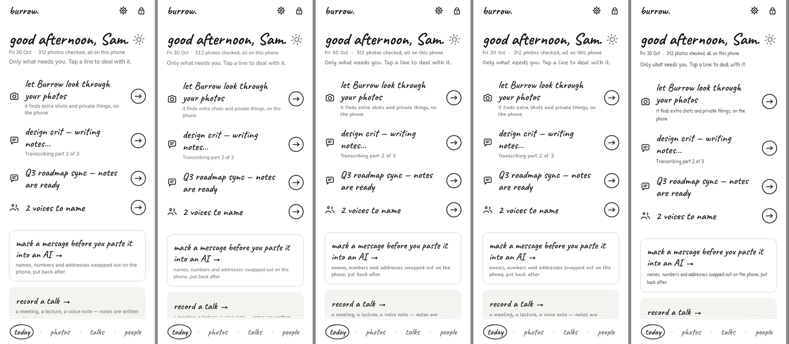

## Components (`ui/hand`)

| Component | What it is |
| --- | --- |
| `HandPage` | The page every screen sits on: a top row (a back doodle or the `burrow.` wordmark, plus actions), a scrolling column capped at 560 dp with 24 dp gutters (so it stays centered on the Fold's inner screen), and an optional sticky bottom area for the ink pill |
| `InkButton` | The primary action: a black pill with Caveat lettering, an optional trailing doodle, a busy state, and a `danger` variant. Disabled is drawn, not faded: a smudge pill with a graphite outline and label |
| `HandLink` | A tertiary action: lettering with a wobbly underline, padded to a 48 dp target |
| `MarkedText` | Text with a marker swipe behind one substring. The swipe has rough ends and a slight tilt, and it follows line wraps |
| `Door` | A hand-lettered line that leads to one of the app's own places, with a circled arrow, an optional red "!", and a meta line |
| `ItemRow` | A row of content: a talk, person, model, file or quote. Its title is the content's own name in `rowTitle`, then a meta line and a caption; a plain pencil arrow when it opens something, or one trailing widget. The selected row in two panes has a smudge background and a 3 dp ink bar |
| `Prose` | Long-form text at reading size, capped at 600 dp and selectable. Renders `**bold**`, `` `code` ``, "-" and "1." lists, "> " quotes and "#" headings (as row titles, never Caveat) |
| `Warning` | An ink sentence with a red "!" in front |
| `HandSwitch` and `SwitchRow` | A drawn toggle (an ink pill with a ticked knob) and the row it sits in on the privacy and permission screens |
| `HandField` | A text well on smudge, with an optional leading doodle |
| `HandNav` | The four-word bottom bar (today, talks, ask, people): equal cells at least 48 high, no separators |
| `Snapshot` | A photo frame that can be tilted or faded |
| `HandTag` | A small label in the body face on smudge (marker-filled only when it is the screen's one fact), with an optional speaker dot; tappable ones get a 48 dp hit area |
| `HandDivider` and `HandProgress` | Wobbly hairlines: a divider, and a progress line that is partly inked |
| `HandSheet` and `ConfirmSheet` | Bottom sheets on paper, with a squiggle as the drag handle |
| `PillButton` | The secondary action: an outlined pill, which is still clearly a button |
| `PageIntro` | Each page's name, plus one line about what you can do on it |
| `Steps` and `StepHead` | Numbered steps for a flow, and numbered section heads for step-by-step pages |
| `PickMark` | The chosen/unchosen tick drawn on a photo |
| `DoneNote` | An inline confirmation, with an optional next-step link |
| `HandEmpty`, `SectionHead`, `SheetTitle`, `Meta`, `Caption`, `Body`, `OnDeviceStamp`, `InitialCircle` | Typography helpers. `SectionHead` has 40 above and 12 below, with its note on its own line underneath |
| `DoodleIcon` | 24 hand-drawn icons on a 24×24 grid, drawn from SVG path strings, with round caps and slightly off-true lines |

The wobble in every stroke is deterministic (seeded), so a line looks drawn by hand but doesn't jitter from one frame to the next.

## Screens

These are rendered on the JVM from the real Compose code, with sample data. The committed PNGs below are from 3.x and still show the old type; re-render them with:

```
./gradlew :app:testDebugUnitTest --tests '*ScreenshotsTest*' --tests '*DesignSystemTest*'
# → app/build/shots/*.png
```

| | | |
| --- | --- | --- |
| 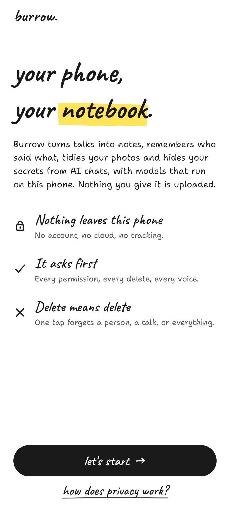 | 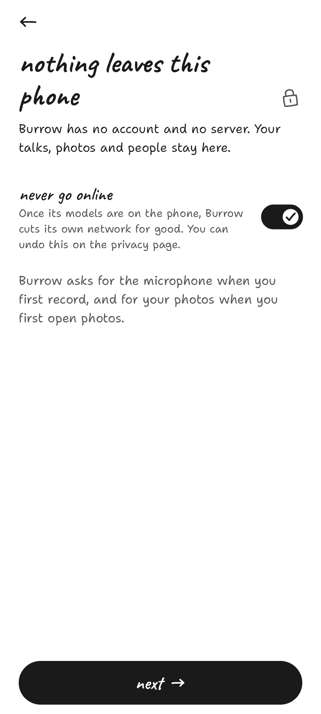 |  |
| 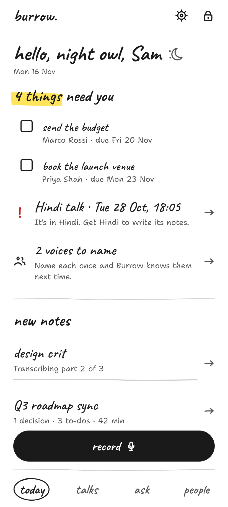 | 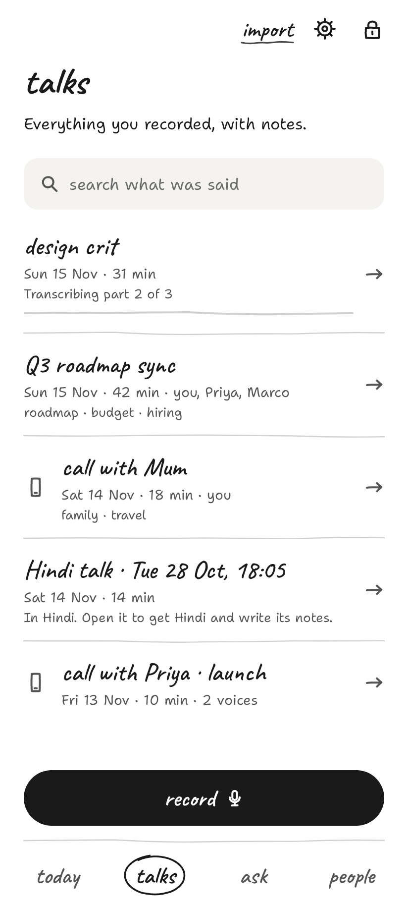 | 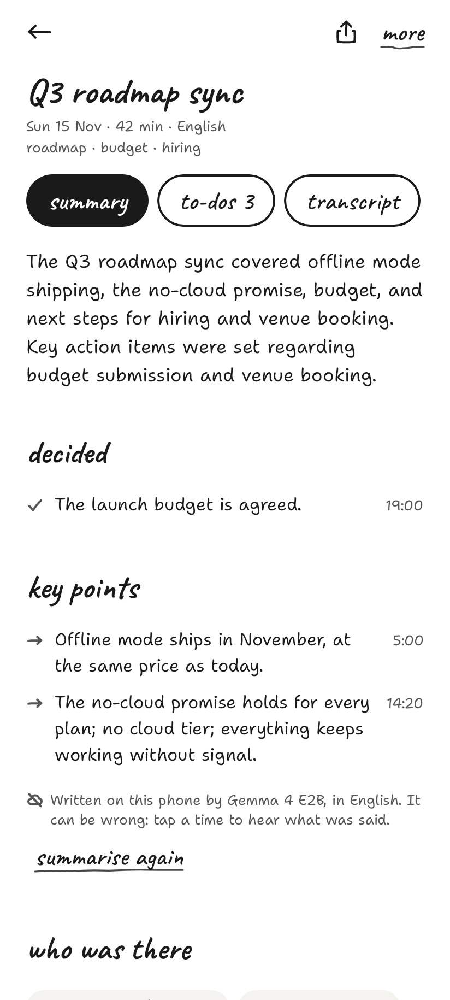 |
| 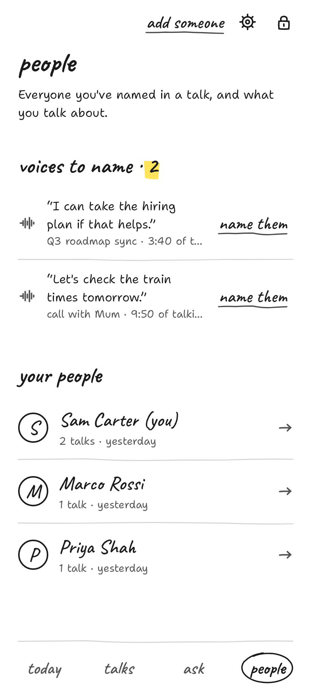 | 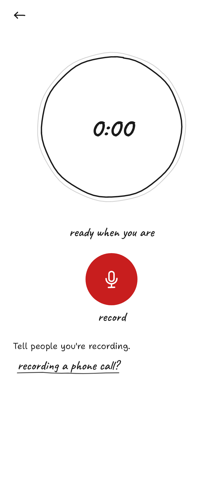 | 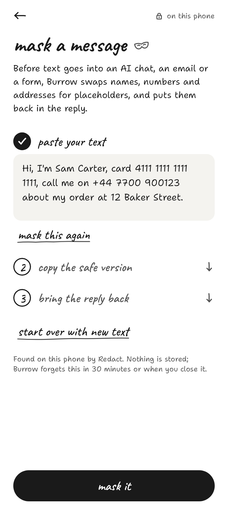 |
| 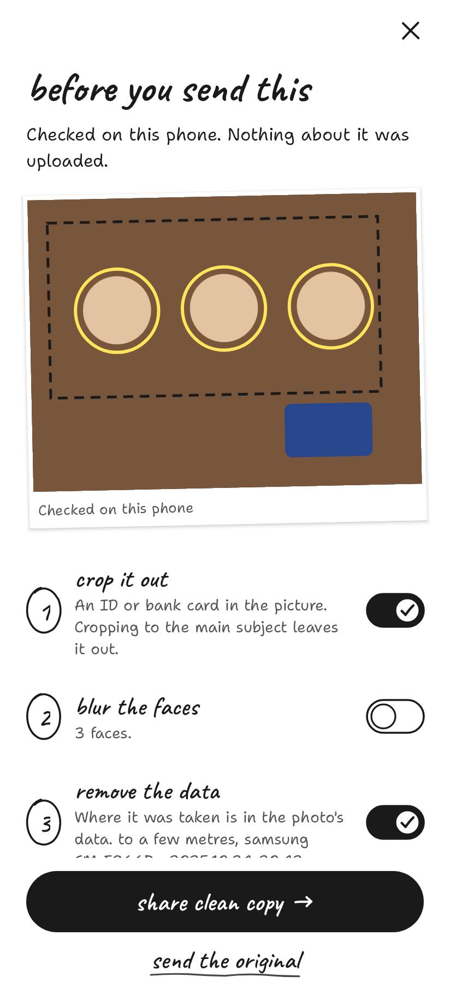 | 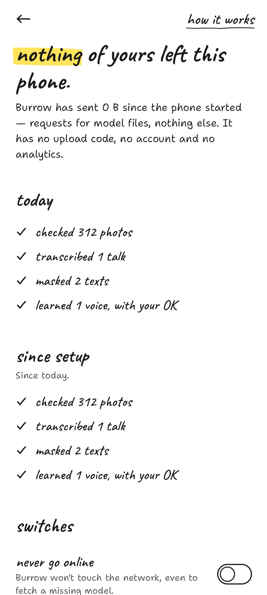 | 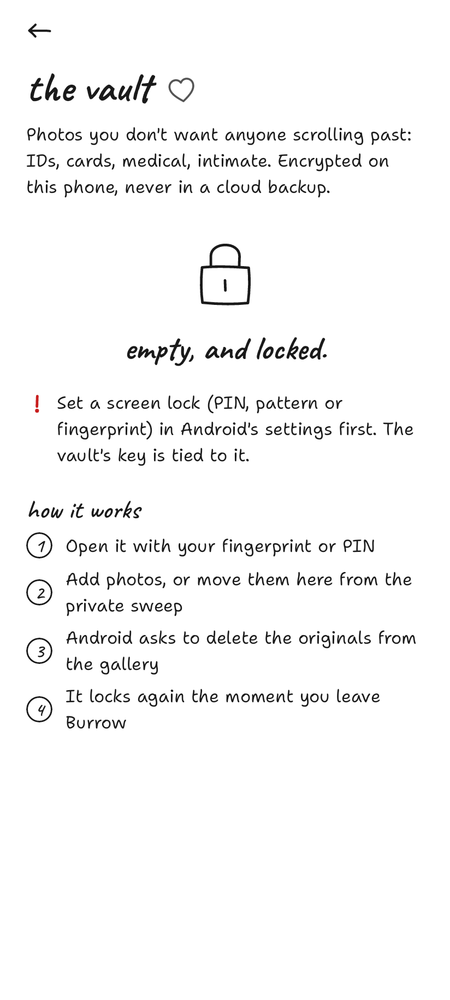 |
| 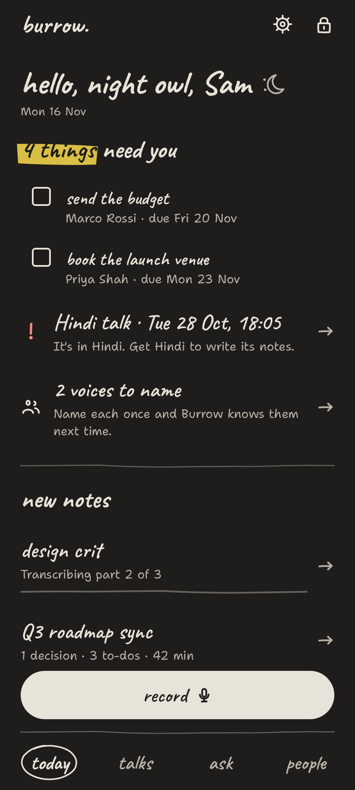 | 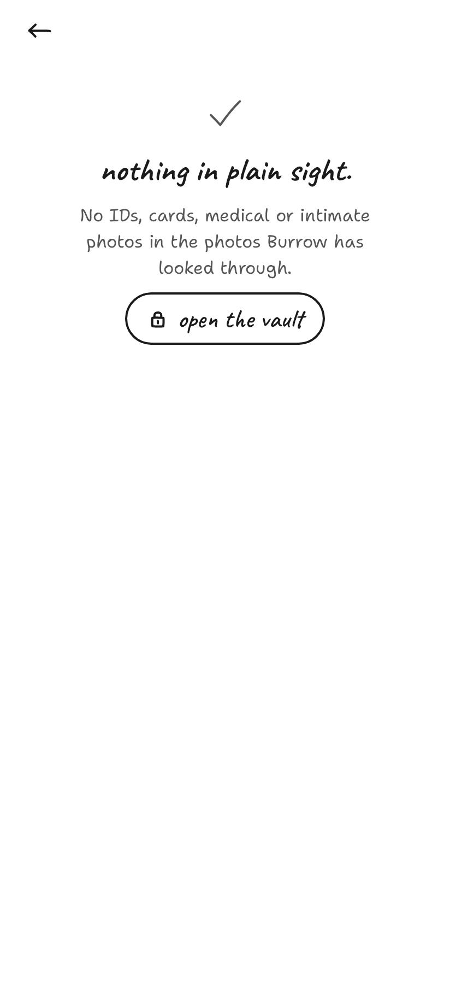 | 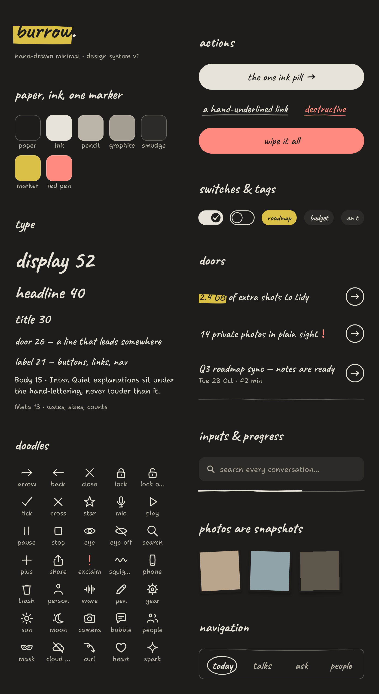 |
| 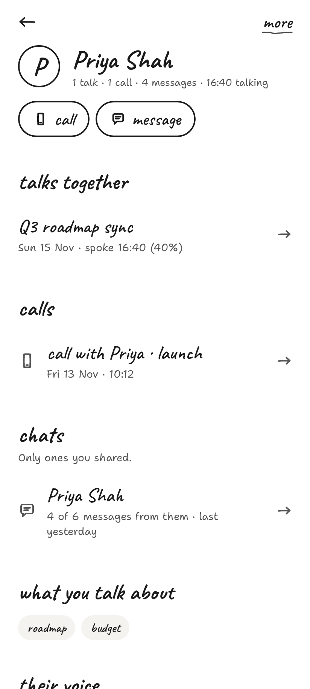 | 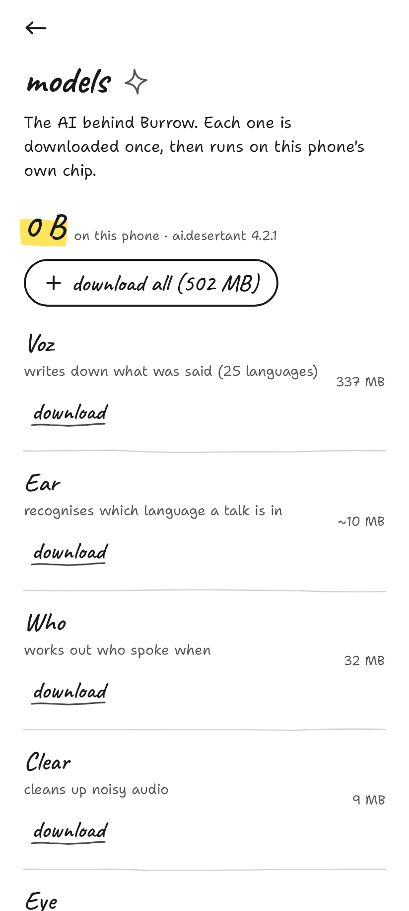 | 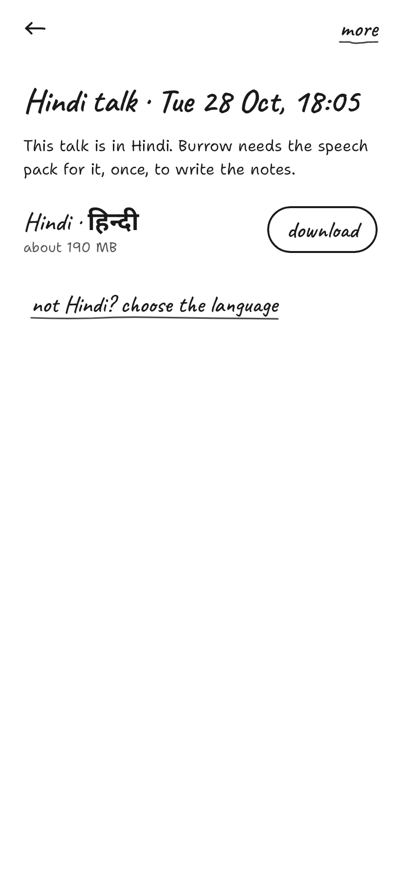 |

## App icon

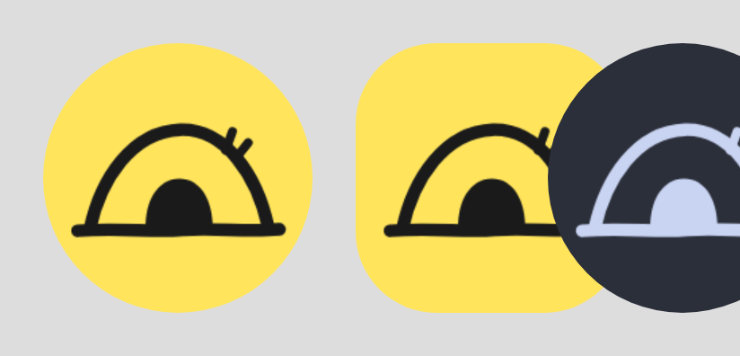

The icon is a hand-drawn burrow mound with its dark entrance, on marker yellow. It's an adaptive icon (`mipmap-anydpi-v26/ic_launcher.xml`), and its monochrome layer lets Android 13+ themed icons tint it. The status-bar icon is the same mark as a silhouette.

On the Fold's inner screen, Talks and People open as two panes side by side:

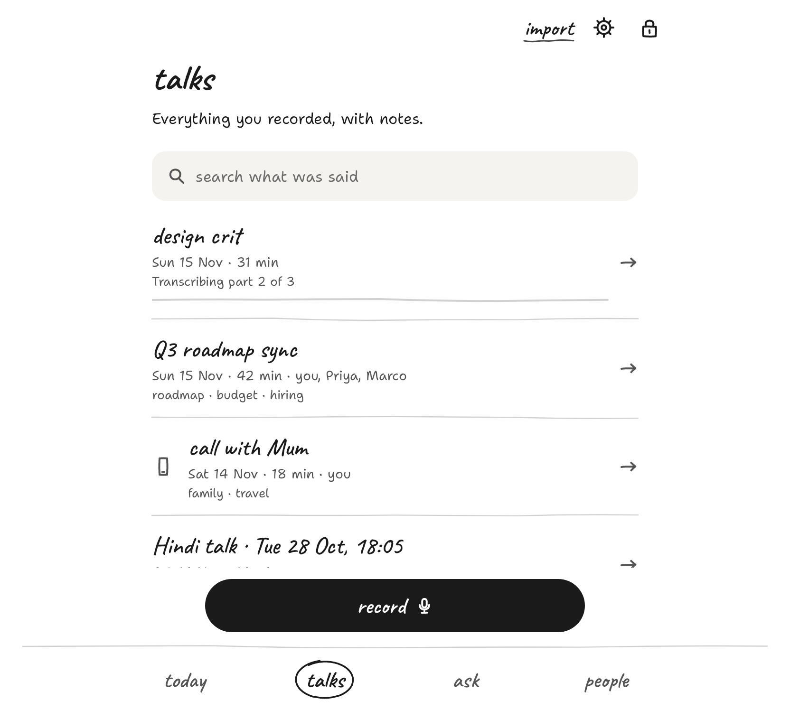
