# Burrow theme: Hand-drawn Minimal

The look of the app reads like a neat notebook page. The paper is white, everything is drawn in ink, and one yellow marker swipe per screen shows what matters. The headings are hand-lettered in Caveat; the explanations sit quietly underneath in Inter.

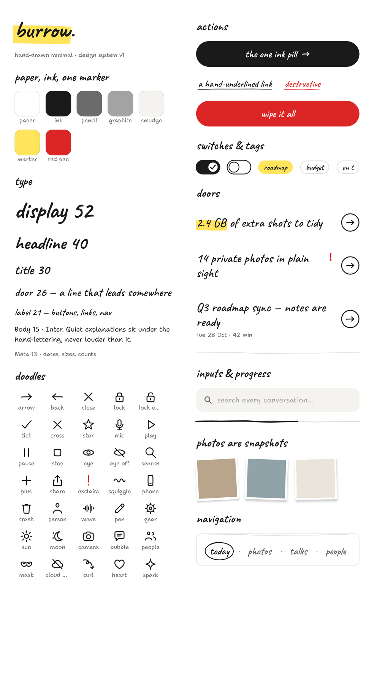

The theme exists in three places, and all three hold the same values:

| Where | What |
| --- | --- |
| [`tokens.json`](tokens.json) | The source of truth: colors (light and dark), type, spacing, stroke and motion |
| `app/src/main/kotlin/…/ui/theme/Theme.kt` | `BurrowTheme`. It maps the tokens onto Material 3 roles, so that any Material widget still in use (menus, dialogs) also comes out in paper and ink |
| `app/src/main/kotlin/…/ui/hand/` | The hand-drawn components and the doodle icon set |
| [`fonts/`](fonts) | Caveat and Inter, both under the SIL Open Font License, bundled in the app with no runtime download |

## Principles

1. **Each screen has one idea and one ink pill.** Every screen gets a single black primary button. Anything secondary is a hand-underlined link.
2. **Only one thing gets the marker.** The yellow swipe goes behind a single word or number per screen, such as "2.4 GB", "you decide" or "nothing". If two things are highlighted, neither of them stands out.
3. **Content sits on the paper, not on cards.** There are no cards, gradients or shadows. Sections are separated by white space and sketchy hairlines. The only filled shape is the pale "smudge" well behind inputs.
4. **Words do the navigation.** The bottom bar is four hand-lettered words (*today · photos · talks · people*), and the current one gets a loose hand-drawn circle around it. There's no icon tab bar.
5. **Photos are snapshots.** They appear small, with a white border, slightly tilted, and with a 2 dp lift. Private photos are always blurred in two ways: the image is decoded at about 24 px and the blur is applied on top, so it stays unreadable even on Android versions that don't support blur.
6. **The red pen is only for private or destructive things.** It's used for the "in plain sight" exclamation mark, the cross on a photo you're letting go, and *wipe everything*.
7. **The text tells the truth.** For example, "recoverable for 30 days", "nothing of yours left this phone" (shown with the real byte count) and "learned 1 voice, with your OK".

## UX rules

These came out of the first round of use, when people said they were lost on some pages.

1. **Every page says what it's for.** A `PageIntro` opens each page: the page's name and one plain sentence about what you can do there.
2. **Anything tappable looks tappable.** Live rows (`Door`) end in a circled arrow. Rows that lead nowhere are drawn in pencil, with no arrow. Actions are buttons (the ink pill, or the outlined `PillButton`); underlined text is only for minor, tertiary actions.
3. **No hidden gestures.** There's no long-press and no tap-on-a-title to rename. Choices are drawn on the photo itself (`PickMark` plus a "keep" or "let go" label), and "look closer" is a visible eye button.
4. **Flows say their steps up front.** `Steps` lists what will happen, such as fingerprint, then copy, then Android's delete prompt. `StepHead` numbers the stages of a page like Mask.
5. **After something happens, say so and offer the next step.** `DoneNote` reports the result inline ("Let go of 12 photos… back to photos"). Failures explain what to do, such as "download Hindi" or "set a screen lock".
6. **Permissions show their state.** Each one shows either "allowed ✓" or an "allow" button, and a "settings" button once Android won't ask again. A switch is never used for something that can't be switched back off.

## Handwriting level and light/dark (3.3)

Headlines are always Caveat. The quieter text under them is a **voice** the user picks in *Settings → handwriting*. There are five stops from formal to handwritten, so the pairing never has to jump from a notebook to a manual:

| Voice | Font | Feel |
| --- | --- | --- |
| formal | Inter | crisp UI sans (3.0–3.2) |
| friendly | Nunito | rounded sans |
| **neat hand** (default) | Shantell Sans, informality 0 | marker-neat; bridges Caveat and a sans |
| loose hand | Shantell Sans, informality 100 | bouncier, more personal |
| all handwritten | Patrick Hand | a notebook throughout |

Shantell Sans ships as one variable font, and Android sets its informality axis live.

*Settings → light or dark* chooses like the phone, light, or dark, independent of the phone. The status-bar icons follow Burrow's choice. Dark is a warm charcoal "night notebook" (see the tokens below), not white on black: that combination made the thin hand strokes bloom and the yellow highlight glare.

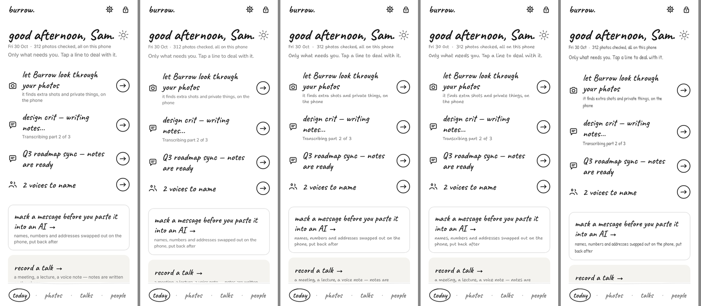

## Tokens

| Token | Light | Dark | Use |
| --- | --- | --- | --- |
| paper | `#FFFFFF` | `#141414` | Background |
| ink | `#1A1A1A` | `#F2F0EA` | Text, doodles, the ink pill |
| pencil | `#6B6B6B` | `#A8A6A0` | Meta lines, secondary text |
| graphite | `#A3A3A3` | `#6E6C67` | Placeholders, disabled items, faded photos |
| rule | ink at 15% | ink at 15% | Sketchy dividers |
| smudge | `#F4F3EF` | `#1F1F1E` | Input wells, the selected row |
| marker | `#FFE45C` | `#FFE45C` | The single highlight per screen. Text on it is always ink `#1A1A1A` |
| red pen | `#DC2626` | `#F87171` | Private and destructive states only |

The type scale uses Caveat for display (52), headline (40), title (30), door (26) and label (21). Inter is used for body (15) and meta (13), and monospace (12) for placeholders like `[NAME_1]` and for timestamps.

## Components (`ui/hand`)

| Component | What it is |
| --- | --- |
| `HandPage` | The page every screen sits on: a top row (a back doodle or the `burrow.` wordmark, plus actions), a scrolling column capped at 560 dp with 24 dp gutters (so it stays centered on the Fold's inner screen), and an optional sticky bottom area for the ink pill |
| `InkButton` | The primary action: a black pill with Caveat lettering, an optional trailing doodle, a busy state, and a `danger` variant |
| `HandLink` | The secondary action: lettering with a wobbly underline |
| `MarkedText` | Text with a marker swipe behind one substring. The swipe has rough ends and a slight tilt, and it follows line wraps |
| `Door` | One big hand-lettered line that leads somewhere, with an optional marker word, a red exclamation mark, and a meta line. Today and Photos are made of doors |
| `HandSwitch` and `SwitchRow` | A drawn toggle (an ink pill with a ticked knob) and the row it sits in on the privacy and permission screens |
| `HandField` | A text well on smudge, with an optional leading doodle |
| `HandNav` | The four-word bottom bar |
| `Snapshot` | A photo frame that can be tilted or faded |
| `HandTag` | A pill label, either outlined or marked |
| `HandDivider` and `HandProgress` | Wobbly hairlines: a divider, and a progress line that is partly inked |
| `HandSheet` and `ConfirmSheet` | Bottom sheets on paper, with a squiggle as the drag handle |
| `PillButton` | The secondary action: an outlined pill, which is still clearly a button |
| `PageIntro` | Each page's name, plus one line about what you can do on it |
| `Steps` and `StepHead` | Numbered steps for a flow, and numbered section heads for step-by-step pages |
| `PickMark` | The chosen/unchosen tick drawn on a photo |
| `DoneNote` | An inline confirmation, with an optional next-step link |
| `HandEmpty`, `SectionHead`, `Meta`, `Body`, `OnDeviceStamp` | Typography helpers |
| `DoodleIcon` | 24 hand-drawn icons on a 24×24 grid, drawn from SVG path strings, with round caps and slightly off-true lines |

The wobble in every stroke is deterministic (seeded), so a line looks drawn by hand but doesn't jitter from one frame to the next.

## Screens

These are rendered on the JVM from the real Compose code, with sample data:

```
./gradlew :app:testDebugUnitTest --tests '*ScreenshotsTest*' --tests '*DesignSystemTest*'
# → app/build/shots/*.png
```

| | | |
| --- | --- | --- |
| 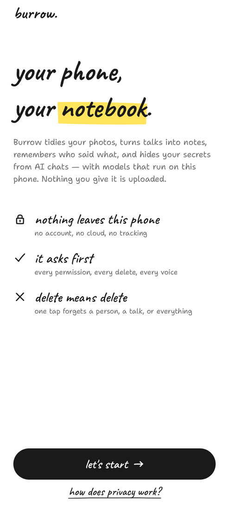 | 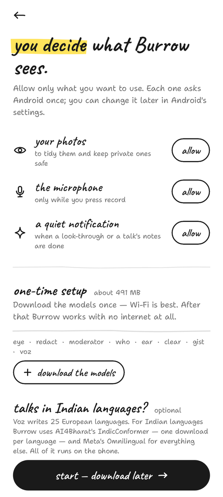 | 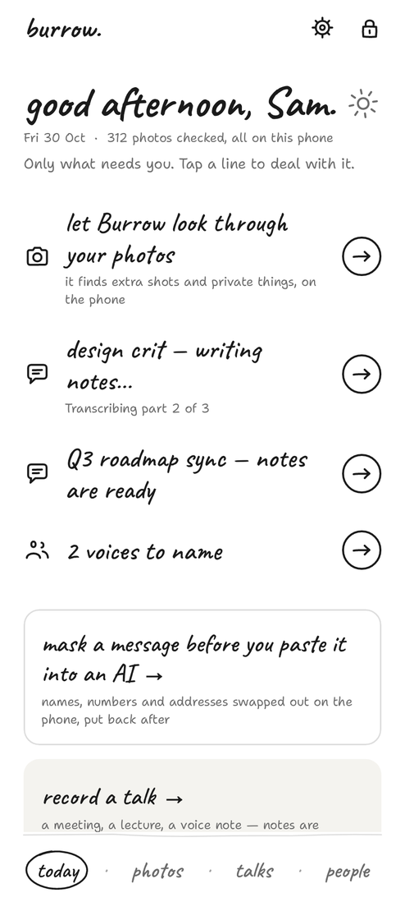 |
| 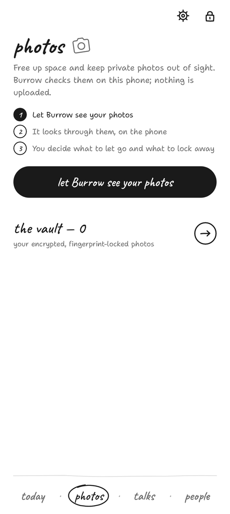 | 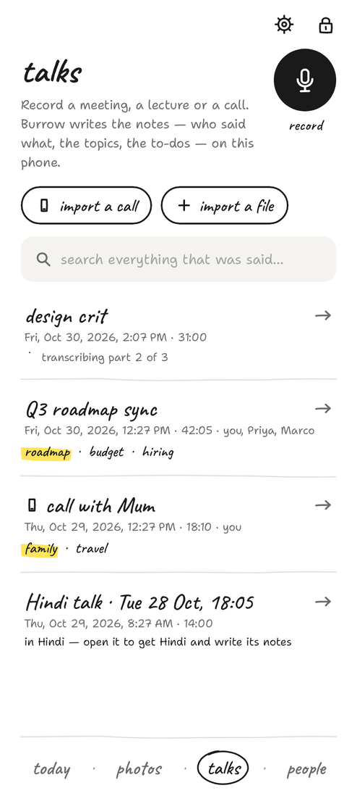 | 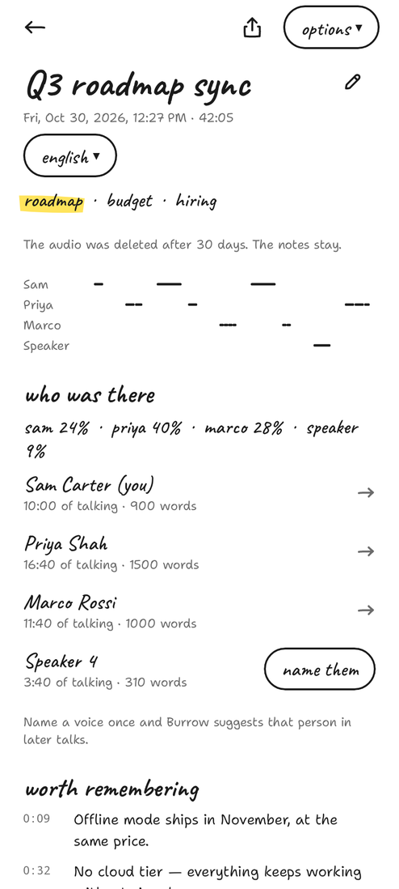 |
| 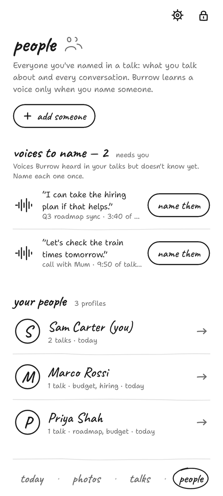 | 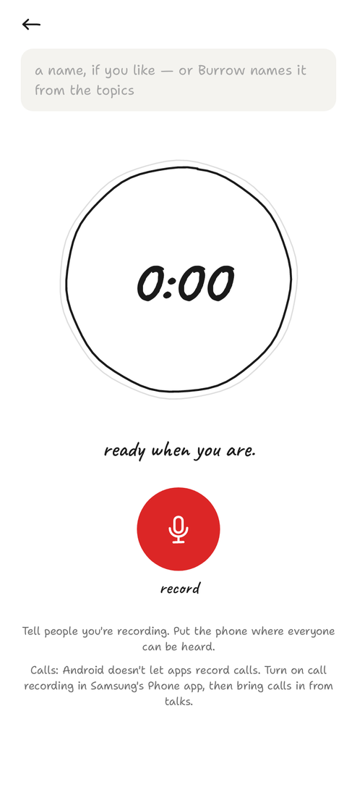 | 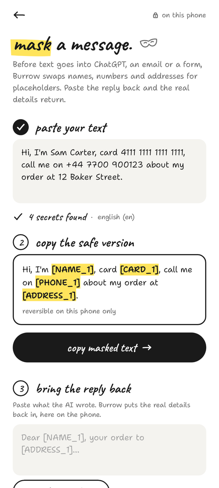 |
| 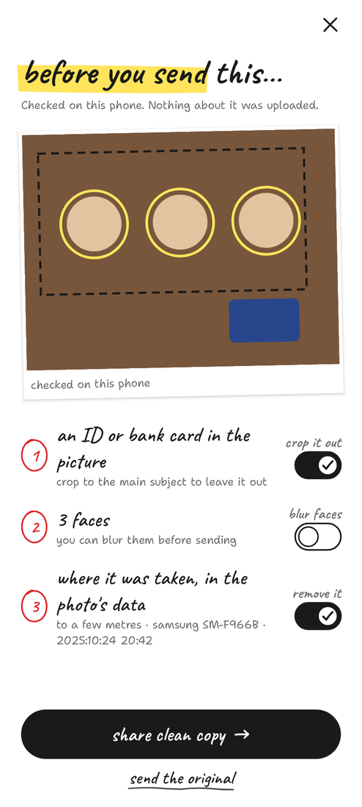 | 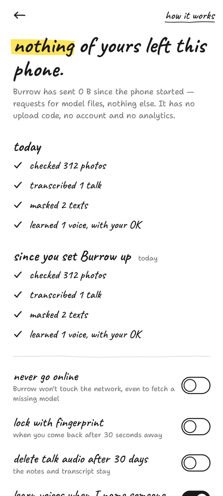 | 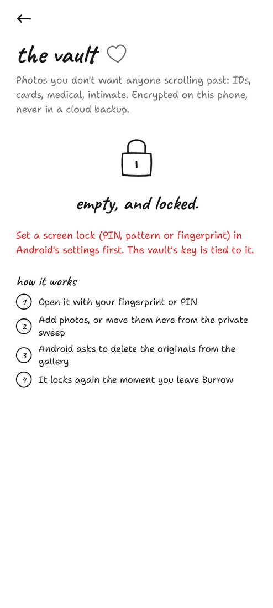 |
| 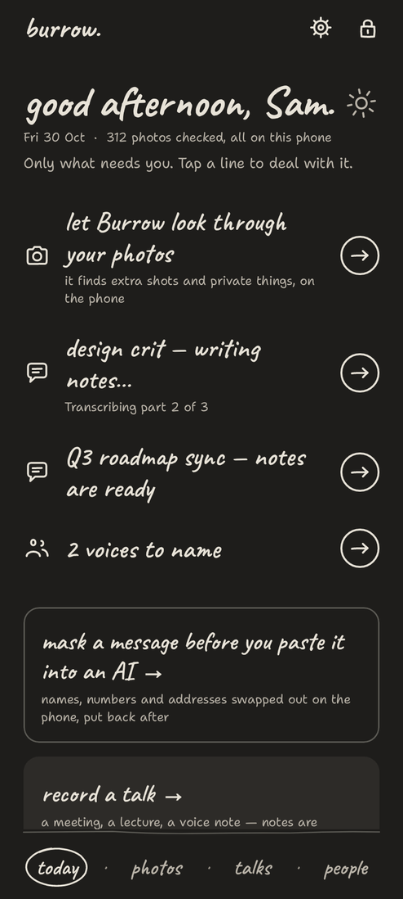 | 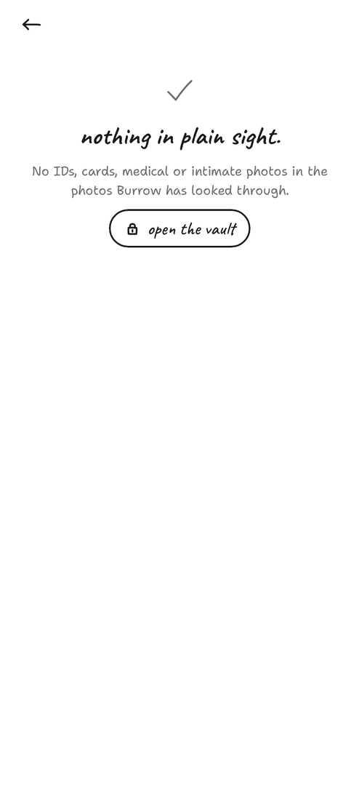 | 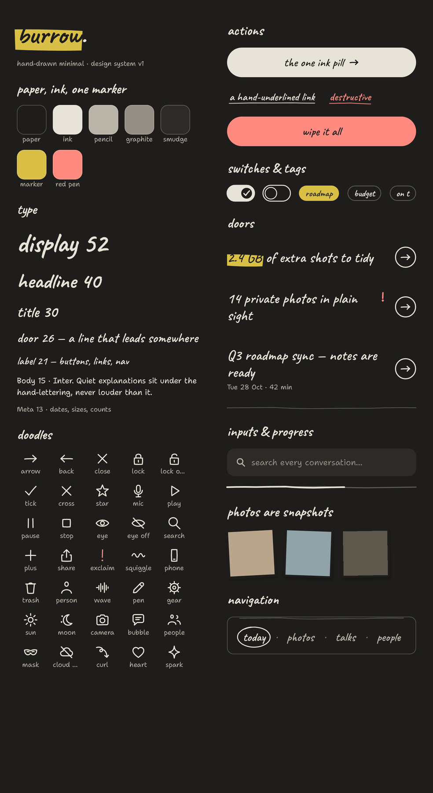 |
| 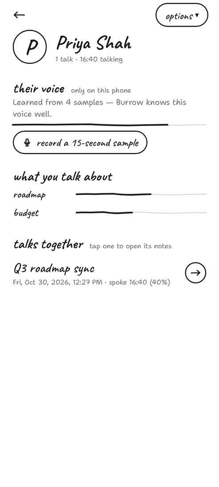 | 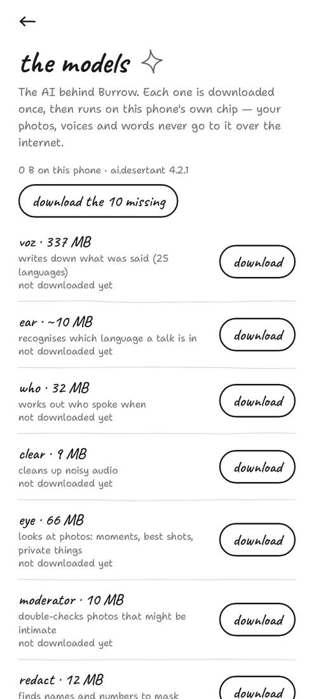 | 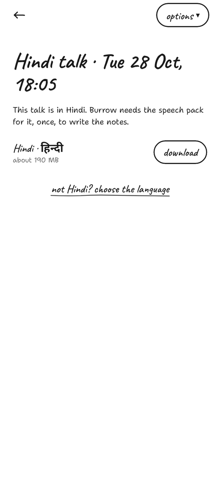 |

## App icon

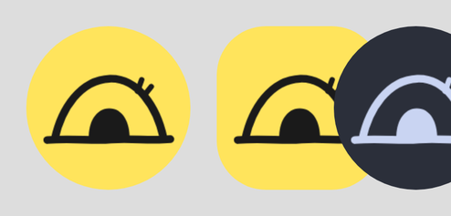

The icon is a hand-drawn burrow mound with its dark entrance, on marker yellow. It's an adaptive icon (`mipmap-anydpi-v26/ic_launcher.xml`), and its monochrome layer lets Android 13+ themed icons tint it. The status-bar icon is the same mark as a silhouette.

On the Fold's inner screen, Talks and People open as two panes side by side:

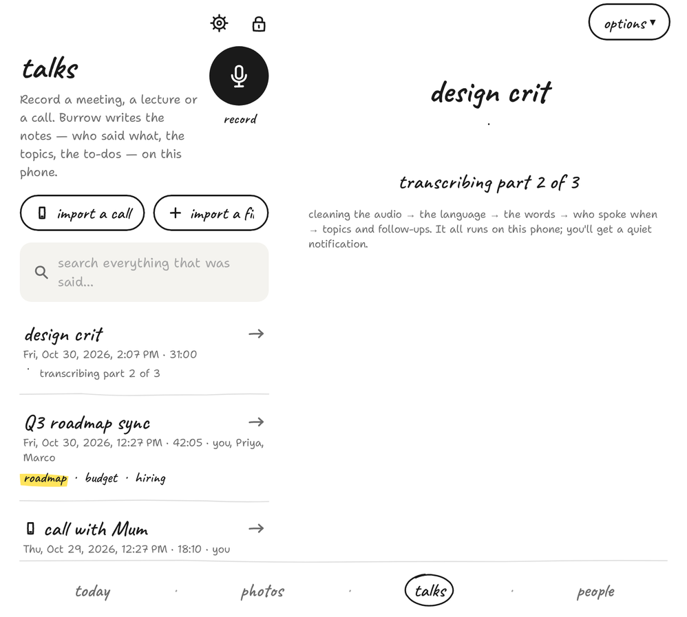
